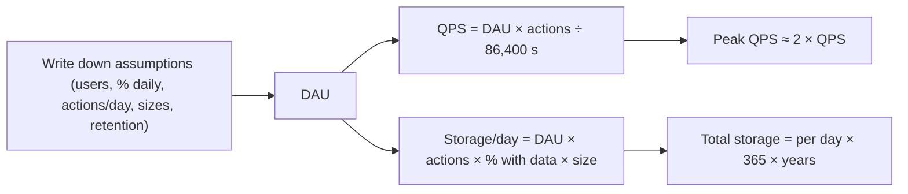
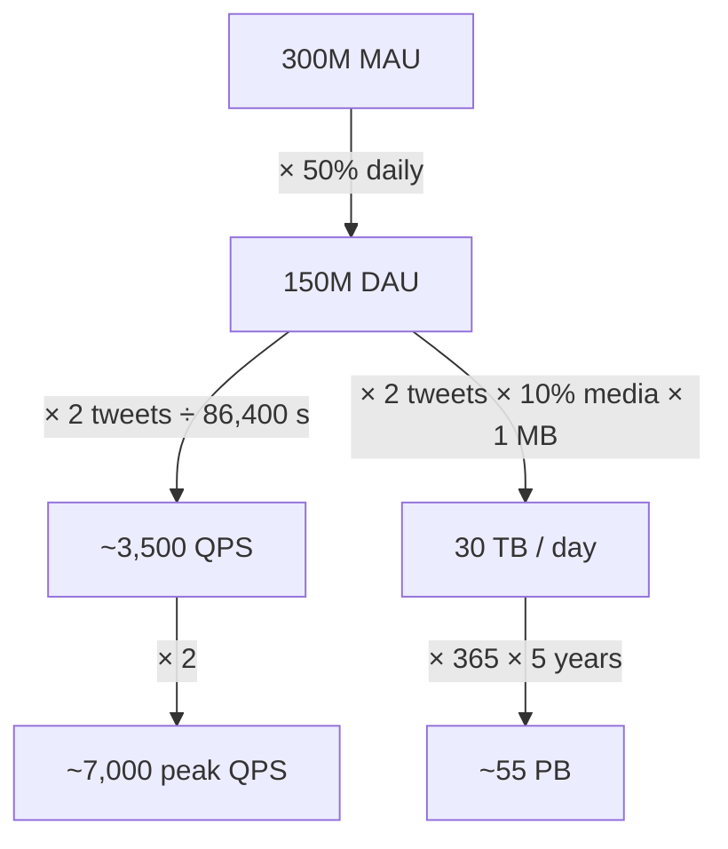

# Ch 2 · Back-of-the-envelope Estimation

> [!abstract] TL;DR
> Estimation = **thought experiments + common performance numbers** → a quick feel for **which designs will meet your requirements** (Jeff Dean, Google Senior Fellow).
> You need 3 sets of numbers: **powers of two**, **latency numbers**, **availability numbers**. Then practice the standard calculations: **QPS, peak QPS, storage, cache, number of servers**.
> The **process** matters more than the result.



---

## 1️⃣ Power of Two

A **byte = 8 bits**. One **ASCII character = 1 byte**.

| Power | Approx. value | Full name | Short |
|---|---|---|---|
| 2¹⁰ | 1 Thousand | 1 Kilobyte | **1 KB** |
| 2²⁰ | 1 Million | 1 Megabyte | **1 MB** |
| 2³⁰ | 1 Billion | 1 Gigabyte | **1 GB** |
| 2⁴⁰ | 1 Trillion | 1 Terabyte | **1 TB** |
| 2⁵⁰ | 1 Quadrillion | 1 Petabyte | **1 PB** |

> [!tip] Memory hook
> Every **+10 in the power = ×1,000 = the next unit**. K → M → G → T → P = thousand → million → billion → trillion → quadrillion.

---

## 2️⃣ Latency Numbers Every Programmer Should Know

Jeff Dean's numbers for typical computer operations (from **2010**). Some are outdated because hardware got faster, but they still show **what is fast and what is slow**.

| Operation | Time | ≈ |
|---|---|---|
| L1 cache reference | 0.5 ns | |
| Branch mispredict | 5 ns | |
| L2 cache reference | 7 ns | |
| Mutex lock/unlock | 100 ns | |
| **Main memory reference** | **100 ns** | |
| Compress 1 KB with Zippy | 10,000 ns | 10 µs |
| Send 2 KB over 1 Gbps network | 20,000 ns | 20 µs |
| **Read 1 MB sequentially from memory** | 250,000 ns | **250 µs** |
| **Round trip within the same data center** | 500,000 ns | **500 µs** |
| **Disk seek** | 10,000,000 ns | **10 ms** |
| Read 1 MB sequentially from the network | 10,000,000 ns | 10 ms |
| **Read 1 MB sequentially from disk** | 30,000,000 ns | **30 ms** |
| **Send packet California → Netherlands → California** | 150,000,000 ns | **150 ms** |

**Units:** 1 ns = 10⁻⁹ s · 1 µs = 10⁻⁶ s = 1,000 ns · 1 ms = 10⁻³ s = 1,000 µs = 1,000,000 ns

```mermaid
flowchart LR
    L1["L1 cache 0.5 ns"] --> MEM["Memory 100 ns"]
    MEM --> MB["1 MB from memory 250 µs"]
    MB --> DC["Round trip in DC 500 µs"]
    DC --> SEEK["Disk seek 10 ms"]
    SEEK --> DISK["1 MB from disk 30 ms"]
    DISK --> WORLD["CA → NL → CA 150 ms"]
    style L1 fill:#d1fae5,stroke:#059669
    style MEM fill:#d1fae5,stroke:#059669
    style MB fill:#fef9c3,stroke:#ca8a04
    style DC fill:#fef9c3,stroke:#ca8a04
    style SEEK fill:#fee2e2,stroke:#dc2626
    style DISK fill:#fee2e2,stroke:#dc2626
    style WORLD fill:#fee2e2,stroke:#dc2626
```



> [!important] The 5 conclusions (memorize these)
> 1. **Memory is fast, disk is slow.**
> 2. **Avoid disk seeks** if possible.
> 3. **Simple compression algorithms are fast.**
> 4. **Compress data before sending it over the internet** if possible.
> 5. **Data centers are usually in different regions**, and sending data between them takes time.

> [!example] Ratios worth knowing (derived from the table)
> - Reading 1 MB from **disk (30 ms)** is **~120× slower** than from **memory (250 µs)**.
> - A **disk seek (10 ms)** costs about **20 round trips** inside a data center (500 µs each).
> - A **cross-continent round trip (150 ms)** costs about **300 in-DC round trips**.
> This is *why* Chapter 1 caches data in memory and puts content near users with a CDN.

---

## 3️⃣ Availability Numbers

- **High availability** = a system's ability to be **continuously operational** for a desirably long period.
- Measured as a **percentage**: 100% = **zero downtime**. Most services fall **between 99% and 100%**.
- **SLA (Service Level Agreement)** = a formal agreement between **you (the service provider) and your customer** defining the **uptime** you'll deliver.
- **Amazon, Google and Microsoft** set their SLAs at **99.9% or above**.
- Uptime is measured in **"nines"**: the more nines, the better.

| Availability | Downtime / day | Downtime / year |
|---|---|---|
| 99% (two nines) | 14.40 minutes | **3.65 days** |
| 99.9% (three nines) | 1.44 minutes | **8.77 hours** |
| 99.99% (four nines) | 8.64 seconds | **52.60 minutes** |
| 99.999% (five nines) | 864 milliseconds | **5.26 minutes** |
| 99.9999% (six nines) | 86.40 milliseconds | **31.56 seconds** |

> [!tip] Pattern
> Each extra nine = **10× less downtime**. Anchor values: 99% ≈ **3.65 days/year**, 99.99% ≈ **~53 min/year**, 99.999% ≈ **~5 min/year**.

---

## 4️⃣ Worked Example · Twitter QPS & Storage

*(The numbers are for the exercise only, not real Twitter data.)*

**Assumptions**
- **300 million** monthly active users (MAU)
- **50%** use Twitter daily
- **2 tweets** per user per day on average
- **10%** of tweets contain media
- Data stored for **5 years**

**QPS**
```
DAU        = 300M × 50%               = 150 million
Tweets QPS = 150M × 2 ÷ 24 h ÷ 3600 s ≈ 3,500
Peak QPS   = 2 × QPS                  ≈ 7,000
```

**Storage (media only)**
```
Tweet size: tweet_id 64 bytes · text 140 bytes · media 1 MB
Media per day = 150M × 2 × 10% × 1 MB = 30 TB / day
5-year media  = 30 TB × 365 × 5       ≈ 55 PB
```



---

## 5️⃣ Tips

> [!success] How to do it well
> - **Rounding & approximation**: precision is *not* expected. "99987 / 9.1" → "100,000 / 10".
> - **Write down your assumptions** so you can refer back to them later.
> - **Label your units**: is "5" 5 KB or 5 MB? Write "5 MB".
> - **Commonly asked estimates**: **QPS, peak QPS, storage, cache, number of servers.** Practice them.
> - It's all about the **process**: solving the problem matters more than the exact result.

> [!note] Extra shortcuts (mine, not from the book)
> - 1 day = 86,400 s ≈ **10⁵ s** (rounds up by ~16%, fine for estimates).
> - **1 million requests/day ≈ 12 QPS** → 100M/day ≈ 1,200 QPS.
> - Million × KB = GB · Million × MB = TB · Billion × KB = TB.
> - **Cache estimate**: often "cache the hottest 20% of a day's data" (the 80/20 rule).
> - **Servers**: peak QPS ÷ QPS one server can handle (state your assumption).

---

## 🃏 Flashcards

1 byte::8 bits
ASCII character size::1 byte
2^30 ≈ ?::1 billion = 1 GB
2^50 ≈ ?::1 quadrillion = 1 PB
Main memory reference::100 ns
Read 1 MB sequentially from memory::250 µs
Round trip within same data center::500 µs
Disk seek::10 ms
Read 1 MB sequentially from disk::30 ms
Packet CA → Netherlands → CA::150 ms
1 ms in ns::1,000,000 ns
5 latency conclusions::Memory fast/disk slow; avoid disk seeks; simple compression is fast; compress before sending over the internet; cross-region transfers take time
SLA::Agreement between provider and customer defining the uptime delivered
Cloud provider SLA level::99.9% or above
99.9% downtime per year::8.77 hours
99.99% downtime per year::52.6 minutes
99.999% downtime per year::5.26 minutes
Peak QPS rule of thumb in the Twitter example::2 × average QPS
Twitter example 5-year media storage::~55 PB
4 estimation tips::Round & approximate; write down assumptions; label units; practice common estimates

---

## 🔗 Related
- Previous: [[Ch01 - Scale From Zero To Millions Of Users]]
- Next: [[Ch03 - A Framework For System Design Interviews]]
- Exam: [[Ch02-03 - Exam]]
