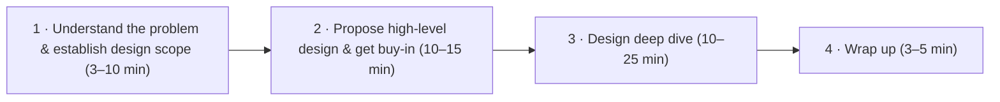
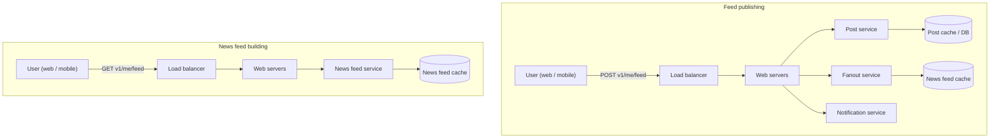
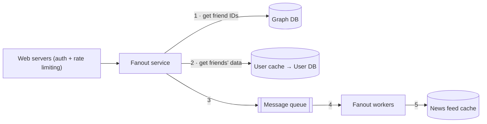

# Ch 3 · A Framework For System Design Interviews

> [!abstract] TL;DR
> Nobody expects you to design a real product in an hour. The interview **simulates two co-workers solving an ambiguous problem together**. The **process matters more than the final design**.
> Use the **4-step framework**: **1. Understand the problem & scope → 2. High-level design & buy-in → 3. Deep dive → 4. Wrap up.**

---

## 🎯 What the Interviewer Is Really Looking For

The interview is **open-ended with no perfect answer**. It lets you show that you can **design, defend your choices, and respond to feedback constructively**.

| ✅ Signals they want | 🚩 Red flags |
|---|---|
| Ability to **collaborate** | **Over-engineering**: loving design purity, ignoring trade-offs and the **compounding costs** |
| Working **under pressure** | **Narrow-mindedness** |
| **Resolving ambiguity** constructively | **Stubbornness** |
| **Asking good questions** (many interviewers specifically look for this) | Answering **without understanding the requirements** |

> [!quote] The interviewer's goal
> To **accurately assess your abilities**. The worst outcome for them is an **inconclusive evaluation** because the session didn't produce enough signals.

---

## Step 1 · Understand the Problem & Establish Design Scope (3–10 min)

> [!warning] Don't be like Jimmy
> Jimmy always answers first ("Because he was HUNGRY!"). In a system design interview, **answering fast without thinking earns no bonus points**. Answering without understanding the requirements is a **huge red flag**. It is **not a trivia contest**; there is no right answer.

- **Slow down. Think deeply. Ask questions** to clarify requirements and assumptions.
- Jumping straight to the final design likely means **designing the wrong system**.
- When you ask, the interviewer either **answers** or tells you to **make an assumption** → **write your assumptions down**; you may need them later.

### Starter questions
1. What **specific features** are we building?
2. How many **users** does the product have?
3. How fast does the company expect to **scale**? Expected scale in **3 months, 6 months, a year**?
4. What is the company's **tech stack**? Which **existing services** could simplify the design?

### Example · News feed system
| Candidate asks | Interviewer answers |
|---|---|
| Mobile app, web app, or both? | **Both** |
| Most important features? | **Make a post** and **see friends' news feed** |
| Reverse chronological order or weighted ranking? | **Reverse chronological** (keep it simple) |
| How many friends can a user have? | **5,000** |
| Traffic volume? | **10 million DAU** |
| Text only, or images and videos? | **Media files: images and videos** |

---

## Step 2 · Propose High-Level Design & Get Buy-in (10–15 min)

Goal: develop a high-level design and **reach agreement with the interviewer**.

- Come up with an **initial blueprint** → **ask for feedback**. Treat the interviewer as a **teammate**.
- **Draw box diagrams** of key components: clients (mobile/web), APIs, web servers, data stores, cache, CDN, message queue…
- Do **back-of-the-envelope calculations** to check the blueprint fits the scale. **Think out loud**, and ask whether estimation is needed before diving in.
- Walk through a few **concrete use cases**: they frame the design and reveal **edge cases**.

> [!question] API endpoints & DB schema at this step?
> **Depends on the problem.** "Design Google search" → too low-level. "Backend for a multiplayer poker game" → fair game. **Ask your interviewer.**

### Example · News feed high-level design
Two flows:
- **Feed publishing**: a post is written to **cache/database** and pushed into **friends' news feeds**.
- **News feed building**: the feed is built by **aggregating friends' posts in reverse chronological order**.

*(Full details in Chapter 11.)*

---

## Step 3 · Design Deep Dive (10–25 min)

**By now you should have:**
- ✅ Agreed on overall **goals and feature scope**
- ✅ Sketched a **high-level blueprint**
- ✅ Got **feedback** on it
- ✅ Some **initial ideas on what to deep-dive**, based on that feedback

**Then:** work with the interviewer to **identify and prioritize components**.

| Interview style | Focus |
|---|---|
| Interviewer hints at staying high-level | Stay high-level |
| **Senior candidate** | **Performance characteristics**: bottlenecks, resource estimations |
| **Most cases** | **Details of some components** |

**Good deep-dive examples:**
- **URL shortener** → the **hash function** that turns a long URL into a short one
- **Chat system** → **reducing latency** and **online/offline status**

> [!warning] Time management
> Don't get lost in minute details that don't show your abilities. E.g. explaining Facebook's **EdgeRank** feed-ranking algorithm in detail **burns time** and **doesn't prove you can design a scalable system**.

**News feed example deep dive:** the two key use cases are **feed publishing** and **news feed retrieval**. In the detailed publishing flow, web servers handle **authentication and rate limiting**; the **fanout service** gets friend IDs from a **graph DB** and friend data from the **user cache/DB**, then puts jobs on a **message queue**; **fanout workers** write into the **news feed cache**. *(Details in Chapter 11.)*

---

## Step 4 · Wrap Up (3–5 min)

The interviewer may ask follow-ups or let you choose topics. Directions:

1. **Identify bottlenecks & improvements**. **Never say your design is perfect**; there's always something to improve. Shows **critical thinking** and leaves a good final impression.
2. **Recap your design**, especially if you suggested several solutions.
3. **Error cases**: server failure, network loss…
4. **Operational issues**: monitoring metrics and error logs, how to **roll out** the system.
5. **The next scale curve**: supports 1M users → what changes for **10M**?
6. **Other refinements** you'd make with more time.

---

## ✅ Dos & ❌ Don'ts

| ✅ Dos | ❌ Don'ts |
|---|---|
| **Always ask for clarification**; don't assume your assumption is correct | Be **unprepared** for typical interview questions |
| **Understand the requirements** | **Jump into a solution** before clarifying requirements & assumptions |
| There's **no right or best answer**: a young startup's design ≠ an established company's with millions of users | Go into **too much detail on one component** early: high-level first, then drill down |
| **Let the interviewer know what you're thinking** | **Hesitate to ask for hints** when stuck |
| **Suggest multiple approaches** if possible | **Think in silence**: communicate |
| After agreeing on the blueprint, go into detail, **most critical components first** | Think you're done after giving the design. **You're done when the interviewer says so.** Ask for feedback **early and often** |
| **Bounce ideas** off the interviewer: a teammate | |
| **Never give up** | |

---

## ⏱️ Time Allocation (45-minute interview, rough guide)

```mermaid
gantt
    title One possible 45-minute split
    dateFormat mm
    axisFormat %M min
    section Steps
    1 · Scope (5)            :s1, 00, 5m
    2 · High-level (12)      :s2, after s1, 12m
    3 · Deep dive (23)       :s3, after s2, 23m
    4 · Wrap up (5)          :s4, after s3, 5m
```

| Step | Time |
|---|---|
| 1 · Understand the problem & scope | **3–10 min** |
| 2 · High-level design & buy-in | **10–15 min** |
| 3 · Design deep dive | **10–25 min** |
| 4 · Wrap up | **3–5 min** |

> [!note] The book's ranges can't all hit their maximum in 45 minutes. The chart shows one split that adds up to 45. Adjust it to the problem's scope and what the interviewer wants.

---

## 🃏 Flashcards

What does the system design interview simulate?::Two co-workers collaborating on an ambiguous problem to find a solution that meets their goals
Final design vs process?::The process matters more than the final design
4 signals interviewers look for::Collaboration, working under pressure, resolving ambiguity constructively, asking good questions
Biggest red flag the chapter names::Over-engineering (design purity, ignoring trade-offs and compounding costs)
Other red flags::Narrow-mindedness, stubbornness
4 steps of the framework::Understand problem & scope; high-level design & buy-in; deep dive; wrap up
Interviewer tells you to assume something → ?::Write the assumption down
4 starter scope questions::Features; number of users; expected scale (3 mo / 6 mo / 1 yr); tech stack & existing services
Include API & schema in step 2?::Depends on the problem: too low-level for Google search, fair for a poker game backend; ask
Deep-dive topic for a URL shortener::The hash function (long URL → short)
Deep-dive topics for a chat system::Reducing latency; online/offline status
Example of too much detail::Explaining Facebook's EdgeRank algorithm
Never say this in the wrap-up::That your design is perfect
6 wrap-up directions::Bottlenecks/improvements; recap; error cases; operations (monitoring, rollout); next scale curve (1M→10M); refinements
When is the interview done?::When the interviewer says it's done
Time split for 45 min::Scope 3–10 · High-level 10–15 · Deep dive 10–25 · Wrap up 3–5

---

## 🔗 Related
- Previous: [[Ch02 - Back-of-the-envelope Estimation]]
- Next: [[Ch04 - Design A Rate Limiter]] (the first problem where you apply this framework)
- News feed full design: [[Ch11 - Design A News Feed System]]
- Exam: [[Ch02-03 - Exam]]
