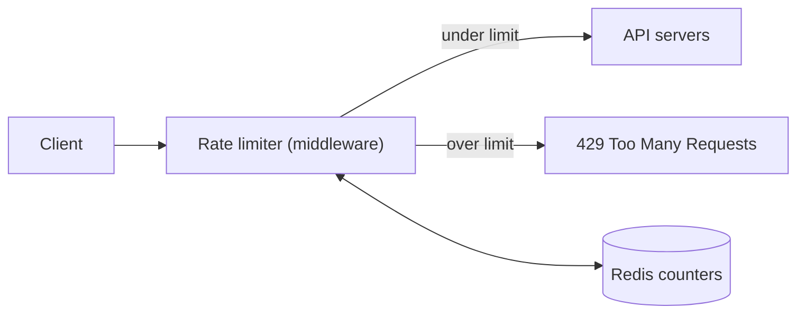
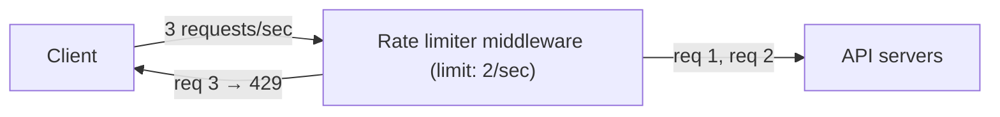
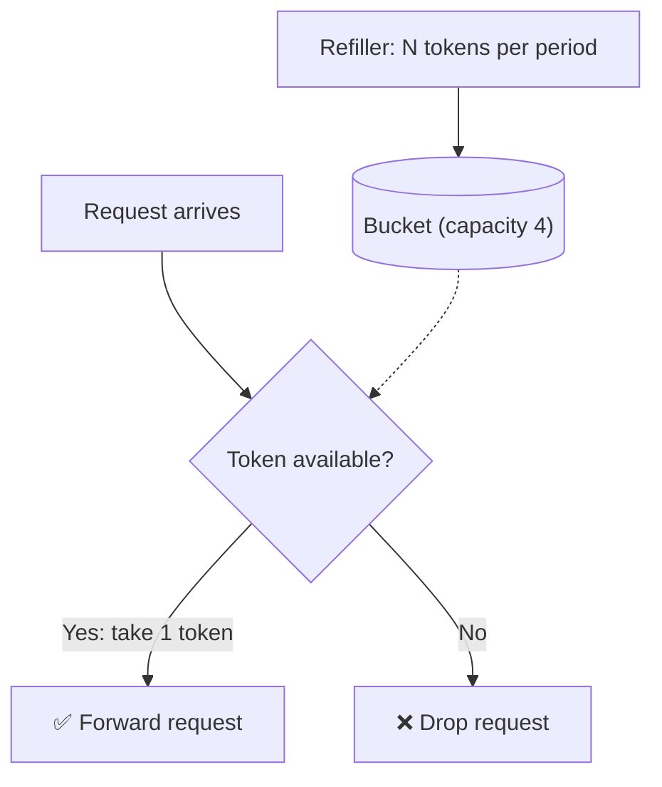
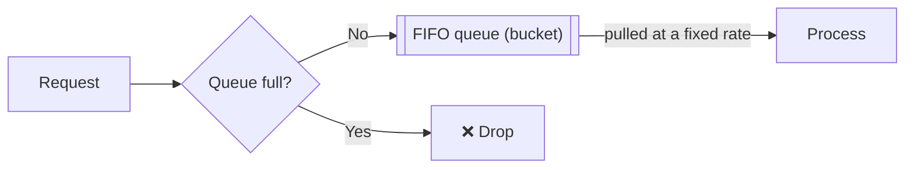
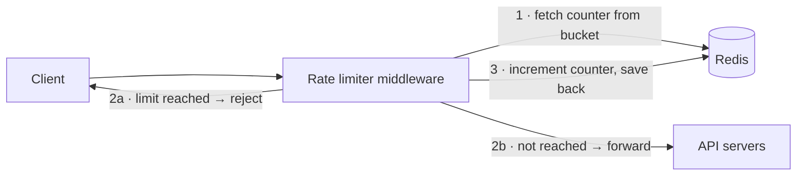
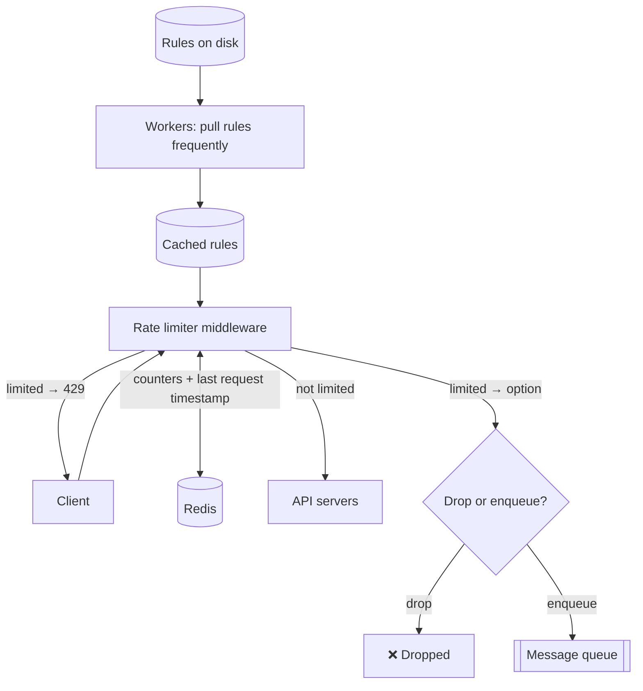
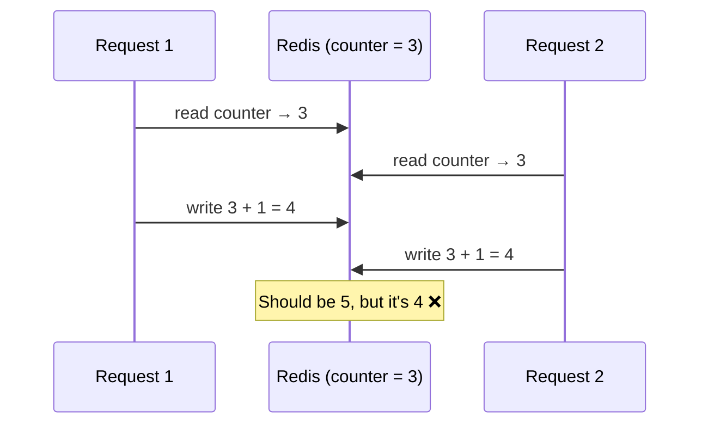
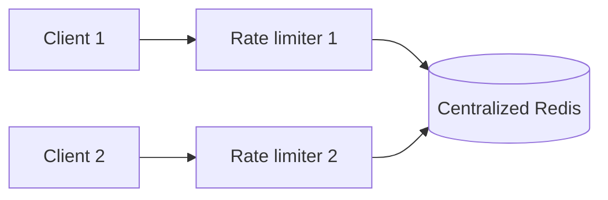

# Ch 4 · Design A Rate Limiter

> [!abstract] TL;DR
> A **rate limiter** controls the **rate of traffic** a client or service can send. Once a request count passes its **threshold** within a time window, extra calls are **blocked**, and the API returns **HTTP 429 Too Many Requests**.
> Know the **5 algorithms**: **token bucket · leaking bucket · fixed window counter · sliding window log · sliding window counter**.
> Store counters in **Redis** (fast, in-memory, `INCR` + `EXPIRE`), keep **rules** in config files cached by workers, and handle the two **distributed problems**: **race conditions** (Lua script / sorted sets) and **synchronization** (centralized Redis, not sticky sessions).



---

## 💡 Why Rate Limit?

| Benefit | Example |
|---|---|
| **Prevent resource starvation from DoS** (intentional or not) | Twitter: **300 tweets / 3 hours**. Google Docs: **300 read requests per user per 60 s** |
| **Reduce cost** | Fewer servers; matters a lot for **paid 3rd-party APIs** charged per call (credit checks, payments, health records) |
| **Prevent server overload** | Filter out excess requests from **bots** or **misbehaving users** |

> [!example] Real-world limits
> - A user can write **no more than 2 posts per second**
> - Create **max 10 accounts per day from the same IP**
> - Claim rewards **no more than 5 times per week from the same device**

---

## Step 1 · Understand the Problem & Scope

| Candidate asks | Interviewer answers |
|---|---|
| Client-side or server-side? | **Server-side API** rate limiter |
| Throttle by IP, user ID, or something else? | **Flexible**: support different throttle rules |
| Scale? Startup or big company? | **Large number of requests** |
| Distributed environment? | **Yes** |
| Separate service or in app code? | **Your design decision** |
| Inform throttled users? | **Yes** |

### Requirements
1. **Accurately limit** excessive requests
2. **Low latency**: must not slow down HTTP response time
3. **Use as little memory as possible**
4. **Distributed rate limiting**: shared across multiple servers/processes
5. **Exception handling**: show clear exceptions to throttled users
6. **High fault tolerance**: if the limiter (e.g. a cache server) goes offline, the **whole system keeps working**

---

## Step 2 · High-Level Design

### Where to put the rate limiter?

| Option | Verdict |
|---|---|
| **Client-side** | ❌ Unreliable: requests can be **forged** by malicious actors; you may **not control** the client implementation |
| **Server-side** | ✅ Inside the API servers |
| **Middleware** | ✅ A separate layer that throttles **before** requests reach the API servers |



- In **microservices**, rate limiting usually lives in an **API gateway**: a fully managed service that also handles **SSL termination, authentication, IP whitelisting, serving static content**…

### Guidelines for choosing (no single right answer)
- **Evaluate your tech stack**: is your language efficient enough for server-side rate limiting?
- **Pick the algorithm that fits business needs**: server-side gives **full control**; a 3rd-party gateway may **limit your choice**.
- **Already have an API gateway** with auth etc.? → add the rate limiter **there**.
- Building your own **takes time**. Not enough engineering resources → use a **commercial API gateway**.

---

## ⚙️ The 5 Algorithms

| Algorithm | Params | ✅ Pros | ❌ Cons | Used by |
|---|---|---|---|---|
| **Token bucket** | Bucket size, refill rate | Easy; memory efficient; **allows short bursts** | Two params **hard to tune** | **Amazon, Stripe** |
| **Leaking bucket** | Bucket (queue) size, outflow rate | Memory efficient; **stable, fixed outflow rate** | Burst fills queue with **old requests** → recent ones dropped; hard to tune | **Shopify** |
| **Fixed window counter** | Window size, threshold | Memory efficient; easy; quota resets suit some use cases | **Spike at window edges** can allow up to **2× the limit** | — |
| **Sliding window log** | Window size, threshold | **Very accurate**: no rolling window ever exceeds the limit | **Lots of memory** (stores timestamps, even rejected ones) | — |
| **Sliding window counter** | Window size, threshold | **Smooths spikes**; memory efficient | **Approximation**: assumes even distribution in the previous window | **Cloudflare** |

### 1️⃣ Token Bucket

A bucket with a **fixed capacity**. A **refiller** adds tokens at a preset rate; once full, extra tokens **overflow**. Each request **consumes one token**.



**How many buckets?** Depends on the rules:
- **Different buckets per API endpoint**: e.g. 1 post/sec, 150 friend adds/day, 5 likes/sec → **3 buckets per user**
- Throttle by **IP** → **one bucket per IP**
- **Global** limit (e.g. 10,000 req/s) → **one shared global bucket**

### 2️⃣ Leaking Bucket

Like token bucket, but requests are **processed at a fixed rate**. Usually a **FIFO queue**.



### 3️⃣ Fixed Window Counter

- Divide time into **fixed windows**; each has a **counter**.
- Each request increments the counter. Over the threshold → **drop** until the next window.

> [!warning] The edge problem
> Limit: **5 requests/minute**, resets at the round minute.
> 5 requests in **2:00:00–2:01:00** + 5 in **2:01:00–2:02:00**. If they all arrive near the boundary, the window **2:00:30–2:01:30** sees **10 requests**: **twice** the allowed rate.

### 4️⃣ Sliding Window Log

1. Keep the **timestamp** of each request, e.g. in a **Redis sorted set**.
2. New request → **remove outdated timestamps** (older than the start of the current window).
3. **Add** the new request's timestamp to the log.
4. Log size **≤ limit** → accept. Otherwise → **reject**.

**Example: limit 2 requests/minute**

| Time | Log after step | Size | Result |
|---|---|---|---|
| 1:00:01 | `[1:00:01]` | 1 | ✅ |
| 1:00:30 | `[1:00:01, 1:00:30]` | 2 | ✅ |
| 1:00:50 | `[1:00:01, 1:00:30, 1:00:50]` | 3 | ❌ (timestamp **stays** in the log) |
| 1:01:40 | remove < 1:00:40 → `[1:00:50, 1:01:40]` | 2 | ✅ |

> [!question] My question: why store rejected timestamps at all?
> You don't have to. **Logging only accepted requests** is a valid variant and caps memory at **O(limit) per user** instead of O(attempts).
> Why the book's version stores everything:
> - **Atomicity is easy**: `ZREMRANGEBYSCORE` → `ZADD` → `ZCARD` in one `MULTI` pipeline, so no check-then-act race. Adding only when allowed needs a **Lua script** (or lock).
> - **Policy**: it counts **attempts**, so clients hammering the API stay blocked until they back off. The downside: a client retrying faster than the limit can lock itself out **indefinitely**.
> - Even the fixed variant still stores **N timestamps per user**, much heavier than the 2 counters of the sliding window counter.

### 5️⃣ Sliding Window Counter

Hybrid of fixed window counter + sliding window log.

> [!important] Formula
> **Requests in rolling window = current window count + previous window count × overlap % of the rolling window with the previous window**

**Example**: limit **7/min**; **5** requests in the previous minute, **3** so far in the current one; a new request arrives **30%** into the current minute.
→ 3 + 5 × **70%** = **6.5** → round down → **6** → under 7 → ✅ accepted (the limit is then reached after one more).

- **Cloudflare experiment**: only **0.003%** of **400 million** requests were wrongly allowed or rate-limited.

---

## 🏗️ High-Level Architecture

Basic idea: a **counter** tracks how many requests come from the same user/IP; over the limit → disallow.

- Where to store counters? **Not a database** (slow disk access). **In-memory cache** (fast + supports **time-based expiration**).
- **Redis** is the popular choice:
  - `INCR`: increment the stored counter by 1
  - `EXPIRE`: set a timeout on the counter; it's **deleted automatically** when it expires



---

## Step 3 · Design Deep Dive

### Rate limiting rules
Written in **configuration files**, saved on **disk**. Example in **Lyft's open-source** rate limiter format:

```yaml
domain: messaging
descriptors:
  - key: message_type
    value: marketing
    rate_limit:
      unit: day
      requests_per_unit: 5      # max 5 marketing messages per day
```

```yaml
domain: auth
descriptors:
  - key: auth_type
    value: login
    rate_limit:
      unit: minute
      requests_per_unit: 5      # max 5 login attempts per minute
```

### Exceeding the limit
- Return **HTTP 429 (Too Many Requests)**.
- Depending on the use case, rate-limited requests may be **enqueued and processed later** (e.g. orders throttled because of system overload).

### Rate limiter headers (how the client knows)

| Header | Meaning |
|---|---|
| `X-Ratelimit-Remaining` | Remaining allowed requests in the window |
| `X-Ratelimit-Limit` | How many calls the client can make per time window |
| `X-Ratelimit-Retry-After` | Seconds to wait before retrying without being throttled |

When throttled: **429** + `X-Ratelimit-Retry-After`.

### Detailed design



---

## 🌐 Rate Limiter in a Distributed Environment

Scaling to multiple servers and concurrent threads raises **2 challenges**.

### 1. Race condition

Logic: **read** counter → check `counter + 1` exceeds the limit → if not, **increment**.



- **Locks** are the obvious fix but **slow the system down significantly**.
- ✅ Better: **Lua script** (runs atomically in Redis) or the **sorted sets** data structure in Redis.

### 2. Synchronization

- Millions of users → **multiple rate limiter servers** → they must **synchronize**.
- The web tier is **stateless**, so client 1 may hit limiter 1 and then limiter 2. Without sync, limiter 1 knows **nothing** about client 2's requests (and vice versa).

| Fix | Verdict |
|---|---|
| **Sticky sessions** (same client → same limiter) | ❌ Not scalable or flexible |
| **Centralized data store (Redis)** shared by all limiters | ✅ Preferred |



### Performance optimization
1. **Multi-data center setup**: latency is high for users far from the DC. Cloud providers have many **geographically distributed edge servers** (Cloudflare: **194** in 2020); traffic is **routed to the closest** edge server automatically.
2. **Synchronize data with an eventual consistency model** (covered in [[Ch06 - Design A Key-Value Store]]).

### Monitoring
Gather analytics to check that:
- the **algorithm** is effective
- the **rules** are effective

E.g. rules **too strict** → many valid requests dropped → **relax** them. During **flash sales**, the limiter may become ineffective → switch to an algorithm that supports **burst traffic**, such as **token bucket**.

---

## Step 4 · Wrap Up (extra talking points)

1. **Hard vs soft rate limiting**
   - **Hard**: requests can **never** exceed the threshold.
   - **Soft**: requests can exceed it **for a short period**.
2. **Rate limiting at different OSI layers**: this chapter covers the **application layer (layer 7, HTTP)**. You can also limit by **IP address with Iptables (layer 3, network/IP)**.

   | # | OSI layer |
   |---|---|
   | 7 | Application |
   | 6 | Presentation |
   | 5 | Session |
   | 4 | Transport |
   | 3 | Network |
   | 2 | Data link |
   | 1 | Physical |
3. **Avoid being rate limited (client best practices)**
   - Use a **client cache** to avoid frequent API calls
   - **Understand the limit**; don't send too many requests in a short time
   - Include code to **catch exceptions/errors** so the client can **recover gracefully**
   - Add **enough back-off time** to **retry logic**

---

## 🃏 Flashcards

What is a rate limiter?::A component that controls the rate of traffic sent by a client or service; excess requests over the threshold are blocked
HTTP status for throttled requests::429 Too Many Requests
3 benefits of rate limiting::Prevent DoS resource starvation; reduce cost (esp. paid 3rd-party APIs); prevent server overload
Why not client-side rate limiting?::Requests can be forged; you may not control the client implementation
Where is rate limiting often placed in microservices?::An API gateway (middleware)
6 requirements of the rate limiter::Accurate limiting; low latency; little memory; distributed; clear exceptions; high fault tolerance
5 rate limiting algorithms::Token bucket, leaking bucket, fixed window counter, sliding window log, sliding window counter
Token bucket parameters::Bucket size and refill rate
Token bucket main advantage::Allows short bursts of traffic as long as tokens remain
Who uses token bucket?::Amazon and Stripe
Leaking bucket parameters::Bucket (queue) size and outflow rate
Leaking bucket data structure::FIFO queue processed at a fixed rate
Who uses leaking bucket?::Shopify
Leaking bucket main con::A burst fills the queue with old requests, so recent requests are dropped
Fixed window counter main con::Traffic spikes at window edges can let up to 2× the limit through
Sliding window log storage::Request timestamps, e.g. in a Redis sorted set
Sliding window log main con::Uses a lot of memory; stores timestamps even of rejected requests
Sliding window counter formula::Current window count + previous window count × overlap % with previous window
Sliding window counter example (limit 7, prev 5, curr 3, 30% in)::3 + 5 × 0.7 = 6.5 → 6 → accepted
Sliding window counter con::Approximation; assumes even distribution of requests in the previous window
Cloudflare sliding window counter error rate::0.003% of 400 million requests
Why store counters in Redis, not a DB?::DB disk access is slow; Redis is in-memory and supports time-based expiration
Two Redis commands for counters::INCR (increment) and EXPIRE (auto-delete after timeout)
Where are rate limiting rules stored?::Config files on disk; workers pull them into a cache
3 rate limiter response headers::X-Ratelimit-Remaining, X-Ratelimit-Limit, X-Ratelimit-Retry-After
Options for a rate-limited request::Drop it (429) or enqueue it in a message queue for later
2 challenges in a distributed rate limiter::Race condition and synchronization
Fixes for race condition::Lua script or Redis sorted sets (locks are too slow)
Fix for synchronization::Centralized data store such as Redis (not sticky sessions)
2 performance optimizations::Multi-DC / edge servers; eventual consistency data sync
Hard vs soft rate limiting::Hard: never exceed the threshold. Soft: can exceed it briefly
Layer covered by the chapter vs Iptables::Layer 7 (HTTP) vs layer 3 (IP)
4 client tips to avoid being throttled::Client cache; respect limits; catch errors gracefully; back-off in retries

---

## 🔗 Related
- Previous: [[Ch03 - A Framework For System Design Interviews]]
- Next: [[Ch05 - Design Consistent Hashing]]
- Eventual consistency: [[Ch06 - Design A Key-Value Store]]
- Rate limiting in the news feed web servers: [[Ch11 - Design A News Feed System]]
