# Ch 1 · Scale From Zero To Millions Of Users

> [!abstract] TL;DR
> Start with **one server**, then remove bottlenecks and **single points of failure (SPOFs)** one by one:
> split web/DB tiers → **load balancer** → **DB replication** → **cache** → **CDN** → **stateless web tier** → **multiple data centers** → **message queue** → **logging/metrics/automation** → **sharding**.
> Every step answers one question: *"What breaks or slows down next?"*

---

## 🗺️ The Evolution at a Glance

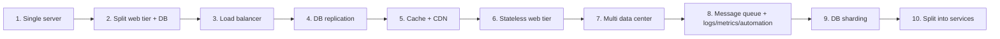

| Step | Problem it solves |
|---|---|
| Split web / DB | Web and data tiers can **scale independently** |
| Load balancer | Web tier **failover** + spread load |
| DB replication | Data tier **failover**, read performance, reliability |
| Cache | Repeated, slow DB reads |
| CDN | Slow **static content** for far-away users |
| Stateless web tier | Enables **horizontal scaling / autoscaling** |
| Multi data center | Geographic latency + **whole-DC outages** |
| Message queue | **Tight coupling**; slow tasks blocking requests |
| Logs / metrics / automation | Visibility + productivity at scale |
| Sharding | DB too big / too much traffic for one machine |

---

## 1️⃣ Single Server Setup

Everything (web app, DB, cache…) runs on **one server**.

### Request flow
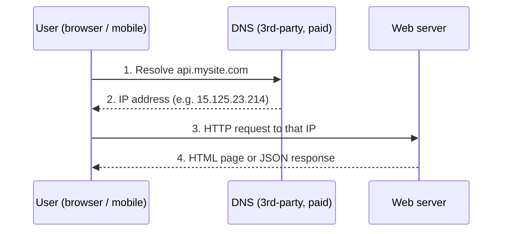

- **DNS** is usually a **paid 3rd-party service**, not hosted on your servers.
- **Traffic sources:**
  - **Web app** → server-side languages (Java, Python…) for business logic & storage; client-side (HTML, JS) for presentation.
  - **Mobile app** → talks **HTTP**; **JSON** is the common response format (simple). e.g. `GET /users/12`

---

## 2️⃣ Database (separate tier)

Split into **web tier** (web/mobile traffic) + **data tier** (database) → each **scales independently**.

### Relational vs Non-relational

| | **Relational (RDBMS / SQL)** | **Non-relational (NoSQL)** |
|---|---|---|
| Examples | MySQL, Oracle, PostgreSQL | CouchDB, Neo4j, Cassandra, HBase, DynamoDB |
| Data model | Tables & rows | 4 categories: **key-value, graph, column, document** |
| Joins | ✅ SQL joins across tables | ❌ Generally not supported |
| Default? | ✅ Best option for **most** devs (40+ years, proven) | When RDBMS doesn't fit |

> [!tip] Choose NoSQL when…
> 1. You need **super-low latency**
> 2. Data is **unstructured** / no relational data
> 3. You only need to **serialize/deserialize** data (JSON, XML, YAML)
> 4. You need to store a **massive amount** of data

---

## 3️⃣ Vertical vs Horizontal Scaling

| | **Vertical — "scale up"** | **Horizontal — "scale out"** |
|---|---|---|
| How | Add more CPU / RAM to **one** server | Add **more servers** to the pool |
| Pro | **Simplicity**; great when traffic is low | No hard ceiling; redundancy |
| Con | **Hard limit** on hardware; **no failover / redundancy** (server dies → site dies) | More complexity |
| Verdict | Small scale | ✅ Preferred for **large-scale** apps |

---

## 4️⃣ Load Balancer

Evenly distributes incoming traffic among web servers in a **load-balanced set**.

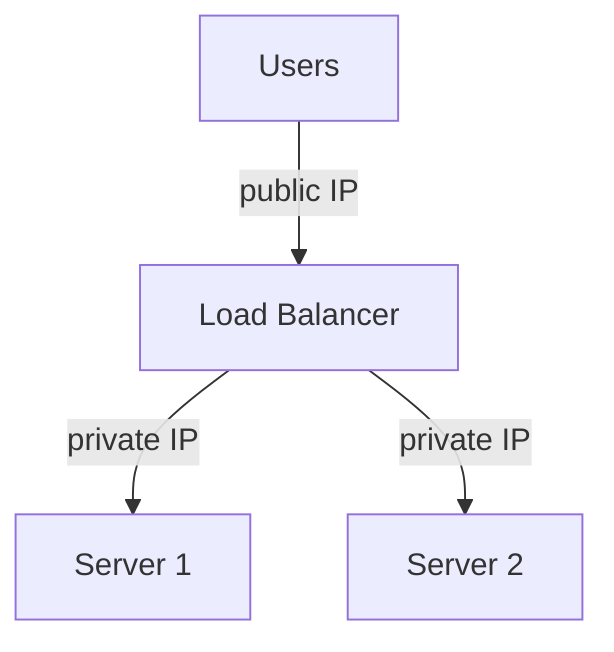

- Users hit the LB's **public IP**; web servers are **no longer directly reachable** by clients.
- LB ↔ servers use **private IPs** (reachable only inside the same network, not over the internet) → **better security**.
- **Server 1 dies** → all traffic goes to Server 2; add a new healthy server to the pool.
- **Traffic grows** → just add servers; LB starts routing to them automatically.

✅ Solves: **no-failover** problem & improves **web-tier availability**.
❓ Next problem: still **one database** → no failover/redundancy in the data tier.

---

## 5️⃣ Database Replication

Master/slave relationship (modern terms: **primary / replica**).

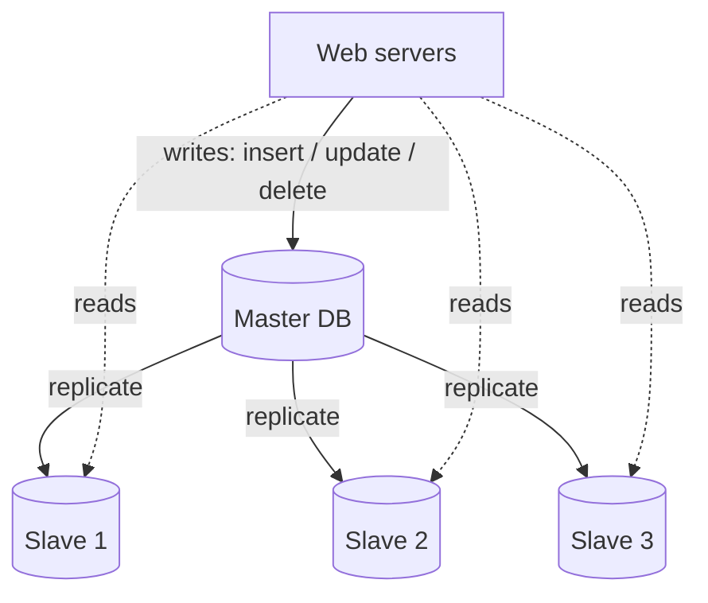

- **Master** → **writes only**. **Slaves** → copies of master data, **reads only**.
- Most apps have **far more reads than writes** → usually **more slaves than masters**.

### Advantages
| Benefit | Why |
|---|---|
| **Better performance** | Reads spread across slaves → more queries **in parallel** |
| **Reliability** | DB destroyed by disaster (typhoon, earthquake)? Data is **replicated across locations** |
| **High availability** | One DB offline? Serve from another |

### Failure handling

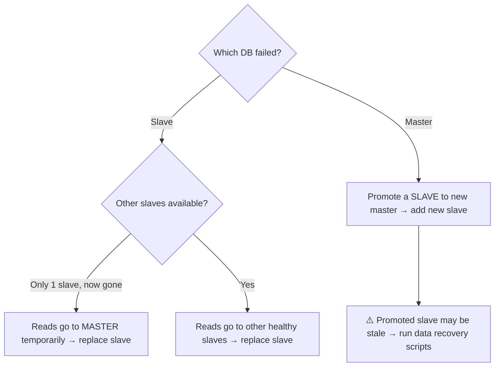

> [!warning] Production reality
> Promoting a new master is complicated because the slave's data may **not be up to date** → missing data must be fixed with **data recovery scripts**. Alternatives like **multi-master** and **circular replication** exist but are more complex (out of the book's scope).

### Design after LB + replication
1. User gets the **LB's IP** from DNS
2. User connects to the LB
3. Request routed to **Server 1 or 2**
4. Web server **reads** from a **slave**
5. Web server sends **writes/updates/deletes** to the **master**

---

## 6️⃣ Cache

A **temporary storage area** holding results of expensive responses or frequently accessed data **in memory** so later requests are faster.

**Cache tier benefits:** better performance · reduces DB workload · scale cache tier **independently**.

### Read-through cache
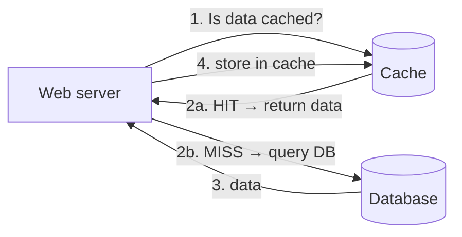

Typical Memcached-style API: `cache.set('myKey', 'hi there', 3600)` · `cache.get('myKey')`

### ⚖️ Cache considerations (memorize these 5)

> [!important] When / Expiration / Consistency / Failures / Eviction
> 1. **When to use** → data **read frequently, modified infrequently**. Cache is **volatile memory** → restart = data lost → keep important data in **persistent stores**.
> 2. **Expiration policy** → always have one. **Too short** = reload from DB too often. **Too long** = **stale** data.
> 3. **Consistency** → keeping DB and cache in sync is hard because writes to both are **not in a single transaction**; even harder **across regions** (see *"Scaling Memcache at Facebook"*).
> 4. **Mitigating failures** → a single cache server is a **SPOF**. Use **multiple cache servers across data centers** + **overprovision memory** by some % as a buffer.
> 5. **Eviction policy** → when full, items get removed. **LRU** (Least Recently Used) is the **most popular**; also **LFU** (Least Frequently Used), **FIFO**.

> [!quote] SPOF definition
> A single point of failure is a part of a system that, if it fails, stops the entire system from working.

---

## 7️⃣ Content Delivery Network (CDN)

A network of **geographically dispersed servers** delivering **static content** (images, videos, CSS, JS).
The CDN server **closest to the user** serves the content → farther from CDN = slower.
*(Dynamic content caching — caching HTML by path, query string, cookies, headers — exists but is out of scope.)*

### CDN workflow
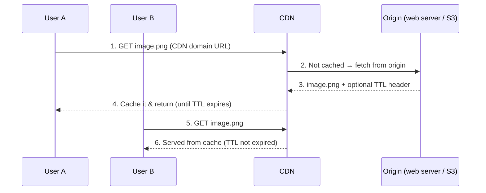

Example CDN URLs: `https://mysite.cloudfront.net/logo.jpg` · `https://mysite.akamai.com/image-manager/img/logo.jpg`

### ⚖️ CDN considerations
| Consideration | Key point |
|---|---|
| **Cost** | 3rd-party; charged for data **in and out**. Move **infrequently used** assets **out** of the CDN. |
| **Cache expiry** | Not too long (stale) / not too short (repeated origin reloads). |
| **CDN fallback** | On CDN outage, clients should **detect it and fetch from origin**. |
| **Invalidating files** | (a) Vendor **invalidation APIs**, or (b) **object versioning**, e.g. `image.png?v=2` |

After cache + CDN: static assets come from the **CDN**; DB load is reduced by **caching**.

---

## 8️⃣ Stateless Web Tier

To scale the web tier horizontally, **move state (e.g. session data) out of web servers** into a shared persistent store.

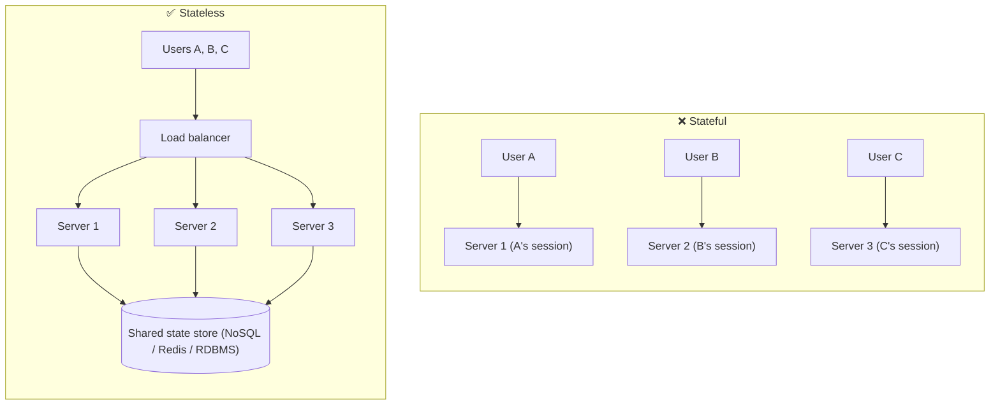

| | Stateful | Stateless |
|---|---|---|
| State lives | On the web server | In a **shared data store** |
| Routing | Same client → **same server** (**sticky sessions**) | Any request → **any server** |
| Downsides | LB overhead; adding/removing servers hard; failures hard | — |
| Result | Fragile | **Simpler, more robust, scalable** |

- Book picks **NoSQL** for the session store because it's **easy to scale**.
- Stateless ⇒ **autoscaling** (add/remove web servers automatically by traffic) becomes easy.

---

## 9️⃣ Data Centers

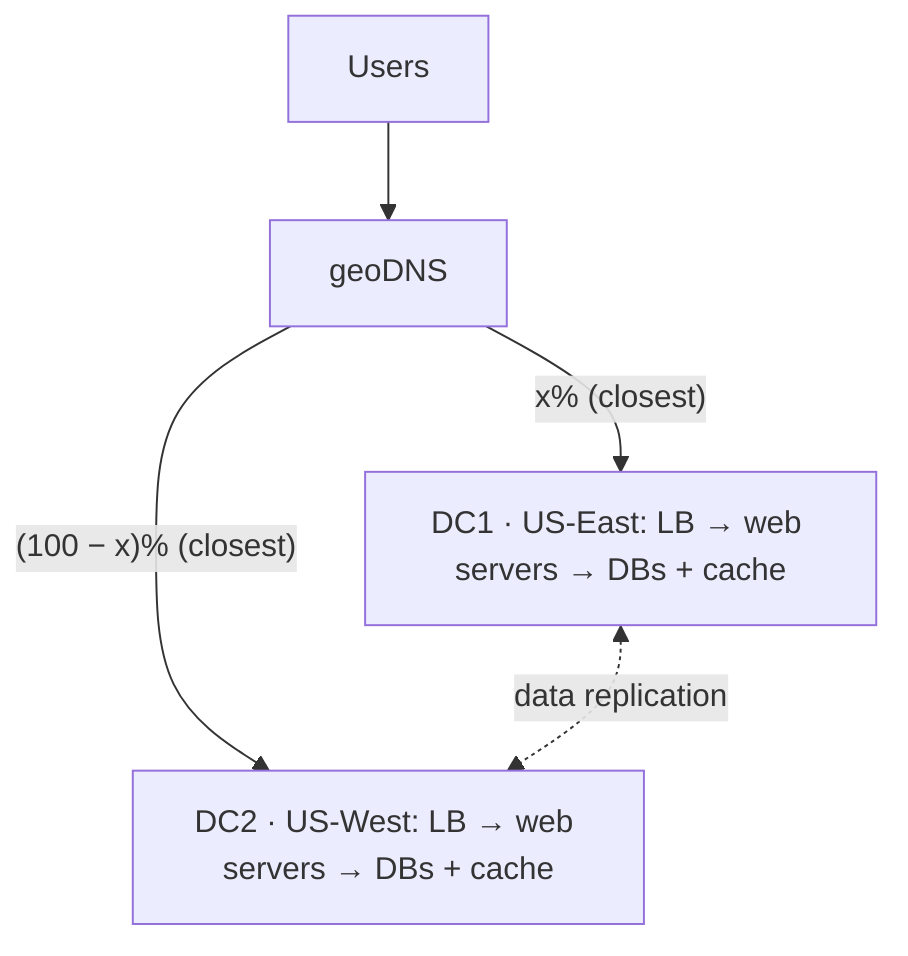

- **geoDNS** (geo-routing): resolves a domain to an IP **based on user location** → closest DC.
- **DC outage** → route **100%** of traffic to the healthy DC.

### Multi-DC challenges
1. **Traffic redirection** → tools like **GeoDNS** route to the nearest DC.
2. **Data synchronization** → after failover, users may land in a DC lacking their data → **replicate data across DCs** (Netflix: **asynchronous** multi-DC replication).
3. **Test & deployment** → test at different locations; **automated deployment** keeps all DCs consistent.

---

## 🔟 Message Queue

A **durable** component, **stored in memory**, supporting **asynchronous communication**. Acts as a **buffer**.

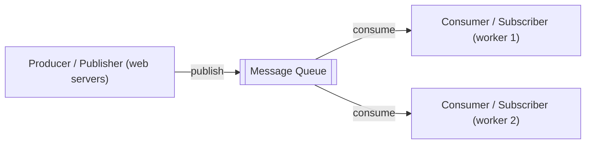

- **Decoupling:** producer can post even if the consumer is **down**; consumer can read even if the producer is **down**.
- Producers and consumers **scale independently**.
- **Example — photo processing** (crop, sharpen, blur): web servers publish jobs → **photo processing workers** handle them async.
  - Queue **growing** → add workers. Queue **mostly empty** → remove workers.

---

## 1️⃣1️⃣ Logging, Metrics, Automation

Nice-to-have for small sites; **essential** for a large business.

- **Logging** → monitor **error logs**, per server or **aggregated** to a central service for search.
- **Metrics:**
  - **Host-level** → CPU, memory, disk I/O
  - **Aggregated-level** → performance of the whole DB tier, cache tier…
  - **Key business** → DAU, retention, revenue
- **Automation** → **Continuous Integration** (each check-in verified automatically → catch problems early); automate **build, test, deploy**.

---

## 1️⃣2️⃣ Database Scaling

### Vertical (scale up)
- Add CPU / RAM / disk. Amazon RDS offers servers with **24 TB RAM**.
- 📌 **Stack Overflow (2013): 10M+ monthly unique visitors with only 1 master DB.**
- ❌ Hardware limits · ❌ greater **SPOF** risk · ❌ **high cost**

### Horizontal = **Sharding**
Split a large DB into smaller parts called **shards**. **Same schema** on every shard, **unique data** per shard.

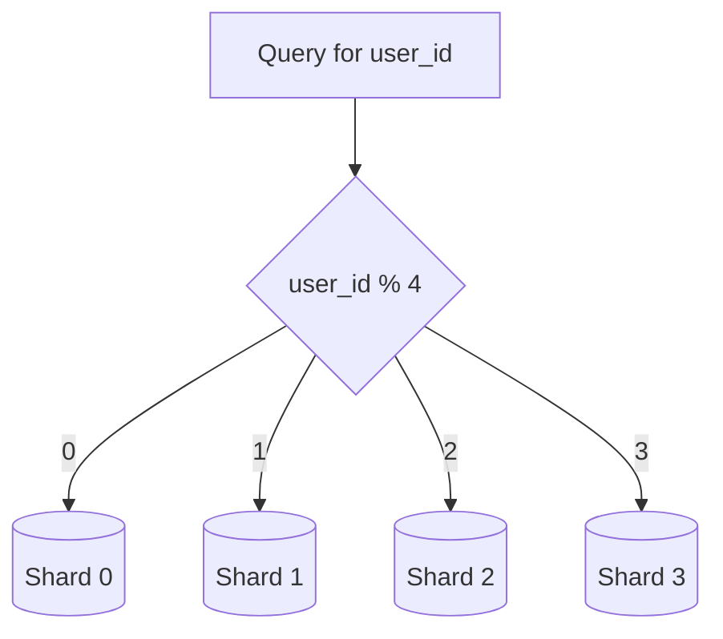

- **Sharding key / partition key** = one or more columns that decide where data goes (here `user_id`).
- 🔑 **Most important decision** in sharding = choosing the key. Criterion: **distributes data evenly**.

### ⚠️ Sharding challenges

| Challenge | What happens | Fix |
|---|---|---|
| **Resharding data** | A shard can't hold more data (rapid growth) or **shard exhaustion** from uneven distribution → update function & move data | **Consistent hashing** (Ch 5) |
| **Celebrity / hotspot key** | One shard overloaded (e.g. Katy Perry, Justin Bieber, Lady Gaga on the same shard) | **Dedicated shard per celebrity**, maybe further partitioned |
| **Join & de-normalization** | **Joins across shards** are hard | **De-normalize** so queries hit a **single table** |

Also: move **non-relational functionality to a NoSQL store** to reduce DB load.

---

## 🏁 Final Architecture

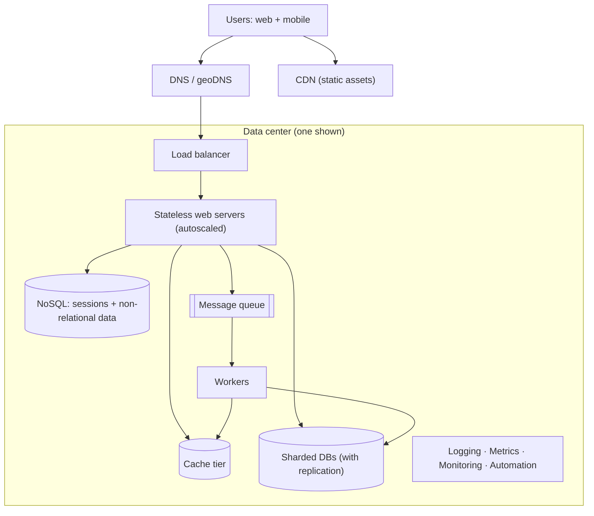

## 🧠 The 8 Commandments (chapter summary)

> [!success] How to scale to millions of users
> 1. Keep the **web tier stateless**
> 2. Build **redundancy at every tier**
> 3. **Cache** data as much as you can
> 4. Support **multiple data centers**
> 5. Host **static assets in a CDN**
> 6. Scale the **data tier by sharding**
> 7. **Split tiers** into individual services
> 8. **Monitor** your system and use **automation** tools

## 🔗 Related
- Next: [[Ch02 - Back-of-the-envelope Estimation]]
- Forward refs: consistent hashing → [[Ch05 - Design Consistent Hashing]] · news feed → [[Ch11 - Design A News Feed System]]

